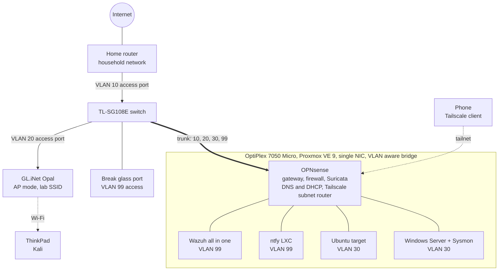
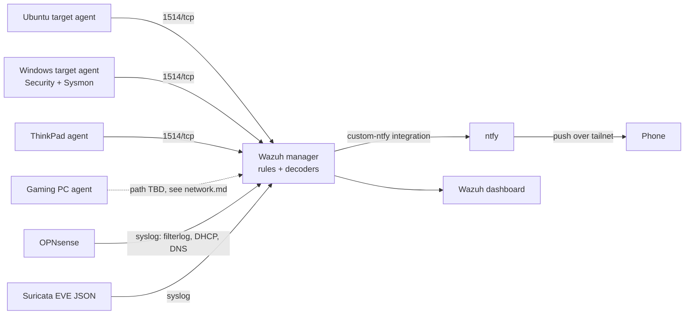

# Architecture

## Physical and logical topology

The home router stays the household gateway. Everything in the lab sits behind OPNsense, so if the 7050 goes down only the lab loses connectivity.

## Log and alert flow

## Guest sizing

| Guest | vCPU | RAM | Disk |
|---|---|---|---|
| OPNsense | 2 | 4 GB | 32 GB |
| Wazuh all in one (Ubuntu 24.04) | 4 | 10 GB | 200 GB |
| Ubuntu target | 2 | 2 GB | 32 GB |
| Windows Server eval + Sysmon | 2 | 6 GB | 64 GB |
| ntfy LXC | 1 | 512 MB | 4 GB |

Total: 11 vCPU on a 4 core host (overcommitted on purpose, the targets sit idle most of the time) and about 22.5 GB of 32 GB RAM, leaving headroom for Proxmox itself.

## Known weak points

- The 7050 is a single point of failure for the lab. Household traffic is unaffected.
- Single NIC means WAN and LAN share one physical link. Fine at home lab volumes.
- Tailscale subnet router SNAT hides the real source of SSH sessions arriving over the tailnet. See [decisions/0004](decisions/0004-tailscale-snat-blind-spot.md).
